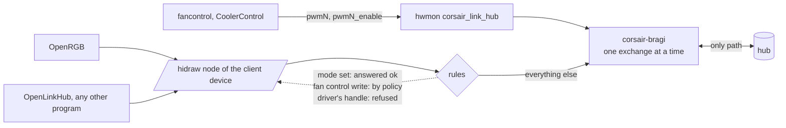

# corsair-bragi

A Linux kernel driver for the Corsair iCUE LINK System Hub (USB `1b1c:0c3f`). It gives the hub's fans and
temperatures to hwmon, so `sensors`, `fancontrol` and CoolerControl work, and it keeps other programs working on the
hub at the same time: OpenRGB for the lights, OpenLinkHub, anything that talks to the hub through hidraw.

Out of tree, installed with DKMS. Licence: GPL-2.0-or-later.

## Status

| | |
|---|---|
| Tested hardware | one hub, firmware 3.10.636, with 2× LX120 RGB and 3× QX140 RGB fans |
| Tested kernels | 6.18, 7.3, 7.4 (x86-64; gcc and clang builds). Older kernels are not tried; the source uses `system_percpu_wq` |
| Tested beside it | CoolerControl 5.1.1 (fans), OpenRGB 1.1 stock (lights), OpenLinkHub |
| Not tested | boot-time binding, suspend and resume, pumps and AIOs, a PSU, more than 14 LINK devices, other firmware, two hubs, lockdep and KASAN kernels |

The driver was written with an AI coding assistant, reviewed against the open implementations named under
[Sources](#sources), and checked on the hardware above. Treat everything under "Not tested" as unknown. A pump
that this driver holds below a safe speed can damage hardware; the driver keeps known pump types at 50 % or more,
and that rule has never run on a pump.

## Why a kernel driver, and why it owns the hub

The hub speaks Corsair's Bragi protocol: a command is one 513-byte report, and the hub answers each with one
512-byte report. Three properties of the hub make sharing it between programs fragile:

- It leaves software mode after 20 to 30 s without traffic and then runs its stored fan curves and lights.
- One mode command resets every fan and closes every open handle.
- A reply names no sender. Two programs on the hub's hidraw node take each other's replies.

So the driver is the one owner. It binds the hub's command interface without a hidraw node and adds a client HID
device with the hub's identity and report descriptor (the layout of mainline `hid-steam`). Programs find that node
as they found the hub's. Every report they write reaches the driver, which sends one command, waits for its reply
(about 2 ms) and then takes the next.



A program keeps the whole protocol, reads of speeds, temperatures, devices and stored tables included, with three
exceptions:

| Command from a program | Answer |
|---|---|
| Mode set (`01 03 00 …`) | status ok, nothing sent: the hub stays in software mode |
| Write to set-speed (`18`) or to a stored fan table (`63 6d`–`65 6d`) | by the `foreign_fan_control` parameter, see below |
| Open, read or write on handle `fd` (the driver's own), or a close list that names it | refused; nothing in such a list is closed |

Details that follow from the hub's report layout, `00 <address> <flags> <command>`:

- The rules apply to every command addressed to the hub (address `00`), whatever its flags.
- Every command goes out with the reply flag set, so the driver sees its outcome. A program that cleared the flag
  gets no reply, as from the hub.
- A command addressed to a LINK device behind the hub (address = its channel) passes unfiltered. Whether such a
  command can change a fan is not tested.
- Every program with the node open sees every reply, as on the hub's own node: hidraw gives input to all readers.
- When the hub does not answer within 500 ms, the program's write fails with `ETIMEDOUT`.
- Interface 1 of the hub has no output report. It keeps a plain hidraw node.

## Install

Needs `dkms`, `rsync` and the kernel headers.

```bash
git clone https://github.com/1vivy/corsair-bragi
cd corsair-bragi
./install.sh
```

`install.sh` copies the three source files to `/usr/src/corsair-bragi-<version>`, builds and installs the module
for every installed kernel, loads it and binds it to the hub. Run it again after a `git pull`; with an unchanged
source it only reloads the module. DKMS rebuilds the module at kernel updates, and the module loads by itself when
the hub is present at boot.

Without DKMS, for a try: `make`, `sudo insmod corsair-bragi.ko`, then the bind loop from `install.sh`.

After a load or reload, restart the programs that had the hub open: the hwmon chip and the hidraw node are new
devices. A program that starts at boot and opens the hub must start after the module has bound it (for a systemd
unit: list `corsair_bragi` in `/etc/modules-load.d/` and order the unit `After=systemd-modules-load.service`).

Check:

```bash
dkms status corsair-bragi
sensors corsair_link_hub-*                        # or: grep . /sys/class/hwmon/hwmon*/name
journalctl -k -b | grep corsair-bragi             # "firmware 3.10.636, 5 LINK devices"
```

Remove: `sudo modprobe -r corsair_bragi` (the hub returns to hardware mode and to `hid-generic`), then
`sudo dkms remove corsair-bragi/<version> --all`.

## Fans and temperatures (hwmon chip `corsair_link_hub`)

File numbers are LINK channel numbers, so a fan keeps its number when a device is added elsewhere on the chain.

| File | Meaning |
|---|---|
| `fanN_input`, `fanN_label` (N = channel 1–25) | RPM; `chN <type>` |
| `pwmN_enable` | `1`: the host duty in `pwmN`. `2`: the curve stored in the hub (the state after load) |
| `pwmN` | duty 0–255. A write also sets `pwmN_enable` to 1. Under `2` it reads what the stored curve gives now (computed by the driver; the hub reports no duty) |
| `pwmN_auto_pointM_temp`, `pwmN_auto_pointM_pwm` (M = 1–7) | the stored curve: millidegrees, duty 0–255. A temperature must stay between its neighbours |
| `pwmN_auto_channels_temp` | the temperature the stored curve follows, one bit: bit K−1 = `tempK` |
| `tempN_input`, `tempN_label` | the sensor of the device on channel N (QX fans have one) |
| `temp26_input`, label `hub` | temperature record 0 [taken to be the hub's own sensor] |

- A fan without a host duty runs its stored curve inside software mode, and its speed stays readable. That is
  `pwmN_enable` = 2. CoolerControl sets 1 when it applies a profile and 2 when it stops, so a stopped daemon leaves
  the fans on the hub's curve; a killed one leaves the last duty.
- The hub returns a fan to its curve, and takes an edited curve, only at a mode change, which also drops every host
  duty and closes every handle. The driver makes that change itself, sends the remaining host duties again at once
  and reopens the handles programs had open. Measured: a host fan held its speed through it.
- Curve edits are written to the hub's stored settings 0.5 s after the last edit, read back and compared. They are
  the settings the hub also uses with no driver at all. Whether they survive a power loss is not tested.
- `pwmN` exists only for the device types in the driver's table of fans and pumps (`bragi_types` in the source).
  Another device with a valid speed gets `fanN_input` alone.
- Pumps (types `07 0c 11 19`, and `1a` model 1) stay at 50 % or more. Fans have no floor: on the tested fans 0 %
  stops them, and 10 % already stops the LX120.
- Readings older than 3 s return `ENODATA`. The hub changes fan speed slowly (LX120: about +50 and −25 RPM per
  second).
- On unbind the driver sends hardware mode: the hub runs its stored curves and lights.

## The one module parameter

`foreign_fan_control` decides what a fan control write from a program on the hidraw node gets:

| Value | Answer |
|---|---|
| `0` (default) | refused with status `05`, and one kernel log line |
| `1` | status ok, dropped |
| `2` | applied: a set-speed write becomes host duties, as a `pwmN` write |

It is `/sys/module/corsair_bragi/parameters/foreign_fan_control`, writable at run time, one value for all hubs. For
a value that survives a reboot: `options corsair_bragi foreign_fan_control=2` in `/etc/modprobe.d/`. With `2`, two
writers (a program and a hwmon daemon) overwrite each other.

## Limits

| Limit | Effect |
|---|---|
| The device list is read when the driver binds, not again | Corsair has LINK devices changed with the PC off, and the next boot reads the new list. After a change with the PC on, run `install.sh` |
| A handle a program leaves open stays followed until it is closed or the module is reloaded | it is reopened at every mode change; the hub keeps it open too |
| "Left software mode" is detected by an open answered `03` | a hub that came back in software mode with its duties reset would not be noticed [not seen] |
| A stored curve table that does not fit one report | no `pwmN_auto_*` files; the tested table is 171 bytes of 502 |
| LINK channels above 25 | no hwmon files, one kernel log line |
| `pwmN` and curve points are whole percent, curve temperatures 0.1 °C | a written value can read back one step off |
| Two hubs give two chips with the same name | tell them apart by the parent device; the client node carries each hub's serial |

## Other hardware

- **HXi SHIFT power supplies** contain this same hub; one owner report puts the PSU on LINK channel 25, type
  `0b`. The driver would give it `fan25_input` and `temp25_input` and no `pwm25` (mainline `corsair-psu` keeps a PSU
  fan read only too). Its volts and amps are not in hwmon. Untested: see [`docs/hid-protocol.md`](docs/hid-protocol.md),
  "PSUs behind a hub".
- **Commander Core, Core XT, ST, Commander Duo** use the same opcodes behind another framing, other resource ids
  and other record layouts. The driver has a variant table with one row; these are not in it.
- The power supplies with their own USB id belong to mainline `corsair-psu`.

## Documentation and tools

| Path | Holds |
|---|---|
| [`docs/hid-protocol.md`](docs/hid-protocol.md) | the hub's commands, consolidated from the open implementations, with sources |
| [`docs/hid-probe.md`](docs/hid-probe.md) | what the hub does, measured: replies, handles, header bytes, both modes, the stored fan tables and how the hub runs them, the duty floor; what the driver takes from each |
| [`tools/`](tools/) | the Python scripts behind those measurements. They talk to the hub's hidraw node as root; two of them write the stored curve table and restore it. Read a script's first lines before you run it |

## Sources

The protocol knowledge comes from these projects; this driver would not exist without them.

- [OpenLinkHub](https://github.com/jurkovic-nikola/OpenLinkHub): hub commands, device table
- [FanControl.CorsairLink](https://github.com/EvanMulawski/FanControl.CorsairLink): status codes, reply parsing,
  captured replies in its tests
- [liquidctl](https://github.com/liquidctl/liquidctl): Commander Core driver and protocol document
- [OpenRGB](https://gitlab.com/CalcProgrammer1/OpenRGB): the hub's colour path
- [ckb-next](https://github.com/ckb-next/ckb-next): Bragi command and property ids
- Linux `drivers/hid/hid-steam.c` (the client device layout) and `drivers/hwmon/corsair-cpro.c` (the hwmon idiom)

Corsair and iCUE are trademarks of Corsair; this project is not affiliated with Corsair.
